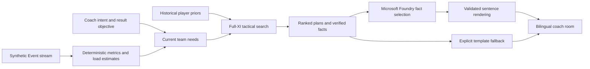

# Live Substitution Intelligence

A football decision-support prototype: identify the team's current needs, compare substitutions and full-XI tactical plans, then explain the inspected alternative. Microsoft × Premier League hackathon project by Thomas, Tal and Ofir.

## Try it

[Azure deployment](https://live-sub-intel-fcfudheze9b5ewfz.swedencentral-01.azurewebsites.net/) is deployed from `main`. Changes on a pull-request branch are not live until merged and deployed. See [current readiness and remaining work](docs/submission/FINAL_CLOSEOUT_HE.md).

```bash
python -m venv .venv
# Activate .venv in your shell, then:
pip install -e ".[dev,llm]"
python scripts/serve_app.py --port 8779
```

Open http://127.0.0.1:8779/?team=24&minute=65&stance=attack&objective=win&inspect=1 . No Azure account or key is needed for deterministic decisions or labelled template explanations.

**The default server mode uses original synthetic match actions and scripted manager substitutions (`--scenario lively`). Use `--scenario original` for the earlier fixed-XI comparison.** It runs offline from committed player/roster metadata; no StatsBomb event download is required. The scripted scenario is not a real match, a prediction, or a calibrated match simulator. Historical player abilities, starting-XI metadata and shirt numbers are disclosed priors. Load and positional suitability are estimates. Inspecting a plan does not execute it or change future events.

For the separate four-team historical research room:

```bash
python scripts/serve_app.py --data-mode historical --port 8778
```

Historical mode replays StatsBomb Open Data and may download pinned raw files. It is a research benchmark, not the synthetic submission demo. `DEMO_DATA_MODE=historical` selects it on a host; the CLI flag takes priority.

## Demonstration

1. Choose Arsenal, minute 65, More attacking, Seek a win. Inspect plans.
2. The primary recommendation and ranked alternatives include threshold gaps, tactical/freshness components, supported formations and retained-player movements.
3. Select the second alternative. Both the proposed pitch and explanation target that plan.
4. Choose Broadcaster for qualitative wording; Analyst exposes numerical model scores. Switch English/Hebrew to check localization.
5. Advance five minutes to see only the events available at that point. Restart or step back to compare a different coach context.

The synthetic scenario includes a sterile attacking period, an opponent goal during minute 54 and later scripted goals. The seeded generator varies actors, timings, shot quality and defensive actions. Goal phases at minutes 54, 78 and 82 remain authored story beats, not sampled match outcomes. The default seed is 20261021; generator metadata is exposed in bootstrap and facts. The event-feed filter reveals pressures, tackles and recoveries. These events do not respond to inspected substitutions. Zero-action and tactical-only outcomes are valid.

## Architecture



The deterministic engine chooses the plan. It searches available one-substitution pairs, six supported shapes and positional assignments, comparing each substitution with the best action without a substitution. Unsupported positions are blocked. Freshness can compensate only a bounded tactical loss. The model selects from verified fact IDs; the app validates the selection and renders trusted localized sentences. It does not accept arbitrary model prose or invented statistics.

The main endpoints are `GET /api/bootstrap`, `POST /api/evaluate`, `POST /api/explain` and `GET /healthz`. Plan identity is validated server-side. Model calls have timeout, concurrency, cache and per-process rate limits. Secrets remain server-side.

## Connect Microsoft Foundry

Set `FOUNDRY_ENDPOINT`, `FOUNDRY_API_KEY` and `FOUNDRY_DEPLOYMENT` in the server environment. Never commit credentials. Use the HTTPS resource endpoint and the deployment name belonging to that resource.

```bash
python scripts/diagnose_foundry.py          # no model calls
python scripts/diagnose_foundry.py --full   # at most two bounded calls
```

`source=llm` on an actual explanation is the acceptance criterion. Configuration presence or a successful Azure deployment is insufficient. Safe failure codes and correlation references appear in the UI and health response. See [runtime diagnosis](docs/FOUNDRY_DIAGNOSIS_20261021.md).

## Validation

```bash
python -m pytest -q
node --test tests/test_coach_room_ui.cjs tests/test_match_replay_ui.cjs tests/test_integrated_ui.cjs
python scripts/audit_integrated_explanations.py --data-mode synthetic
python scripts/audit_integrated_explanations.py --data-mode historical
```

On 21 October: 198 Python tests and 13 Node tests passed locally. The synthetic audit checked 36 checkpoints, 1,255 offered plan contexts and 7,530 rendered explanations; the historical audit checked 72 checkpoints and 12,420 explanations. These are contract/consistency checks, **not football accuracy or evidence that substitutions improve results**. See the JSON reports in `docs/research/`.

## Limits and data attribution

- One substitution at a time; a bounded formation catalog; no goalkeeper or ten-player tactical search.
- Position suitability, role exposure and physical load are heuristic. Freshness/threshold calibration needs independent football review.
- Historical cards are frozen at their documented cutoff. FIFA16-derived priors and disclosed synthetic card fallbacks are not live-season ratings. Their redistribution rights still require team review before final submission.
- StatsBomb Open Data is the source of historical research events, pre-cutoff evidence and roster metadata. See [StatsBomb Open Data](https://github.com/statsbomb/open-data) and the attribution/licensing terms there. Do not present historical events as licensed live Premier League data.
- Current LLM integration is constrained fact selection, not an autonomous tool-calling coach. Do not claim agentic functionality that is absent.

[Submission draft](docs/submission/SUBMISSION.md) · [Scoring and position-fit details](docs/AUTO_TACTICAL_PLANS.md) · [Integrated API and explanation design](docs/INTEGRATED_ROOM.md) · [Player cards and workbook](docs/player-cards/README.md) · [Deployment guide](docs/AZURE_DEPLOY_HE.md)

Older dated reports describe previous versions; the run commands and scope on this page take precedence.

[Seeded generator revision and live Foundry acceptance findings](docs/SEEDED_DEMO_REVIEW_HE.md).

## Match statistics and player markers

The live board shows cumulative xG, shots, shots on target, pass attempts and pass accuracy, plus an explicitly labelled event-control-time possession estimate. Shirt markers show match-to-date cards, goals and linked assists. Counts rewind with the replay clock; sent-off players move below the pitch. Control intervals are inferred from successful ball-control events; pressure does not transfer possession, dead-ball/unknown periods are excluded, and ownership expires after 30 seconds without control evidence. Coverage is shown. This is an estimate, not provider-measured possession. No ten-player tactical solver is claimed. See [formulas, sources and integration notes](docs/MATCH_STATS_BADGES_HE.md).

[Pass-quality fixes, need semantics and local-vs-Azure explanation status](docs/POSSESSION_AND_PASS_QUALITY_HE.md).

[Late win-pursuit weighting and Azure integration handoff](docs/AZURE_FINAL_INTEGRATION_HE.md).

[Compact dashboard layout and fixed-seed scenario guide](docs/COMPACT_UI_HANDOFF_HE.md).

## Submission package

- [Closeout and remaining work](docs/submission/FINAL_CLOSEOUT_HE.md)
- [Claude integration handoff](docs/submission/CLAUDE_HANDOFF.md)
- [English demo video script](docs/submission/VIDEO_SCRIPT.md)
- [English submission draft](docs/submission/SUBMISSION.md)
- [Data sources and publication limitations](docs/submission/DATA_SOURCES.md)

Generated research ZIP/Excel/preview artifacts are not bundled. Data provenance remains documented; artifact cleanup is not license clearance.
